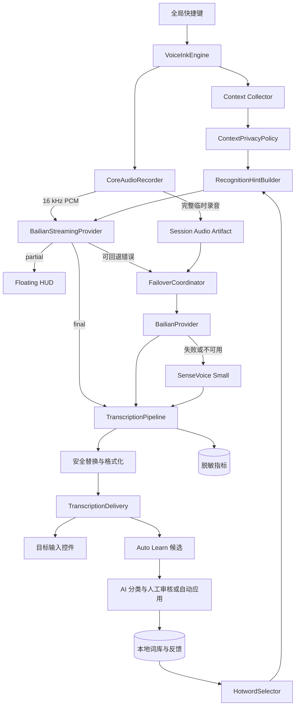
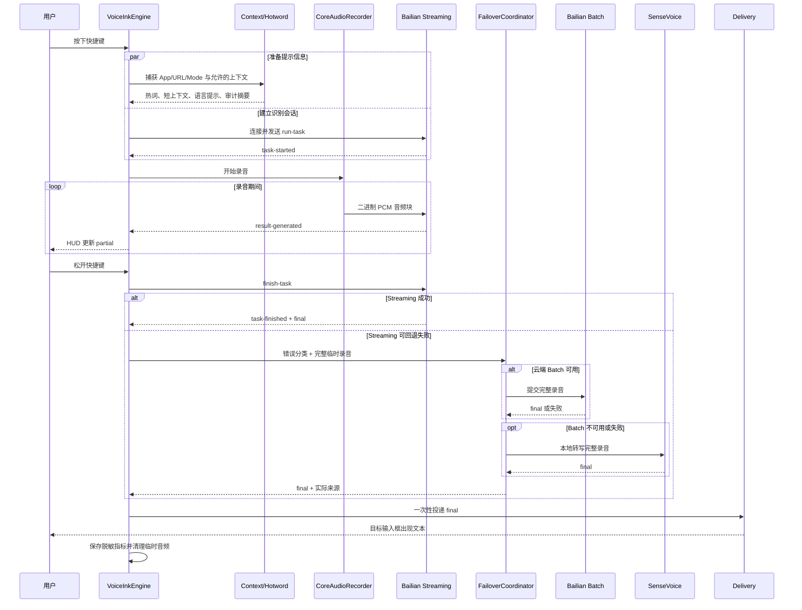
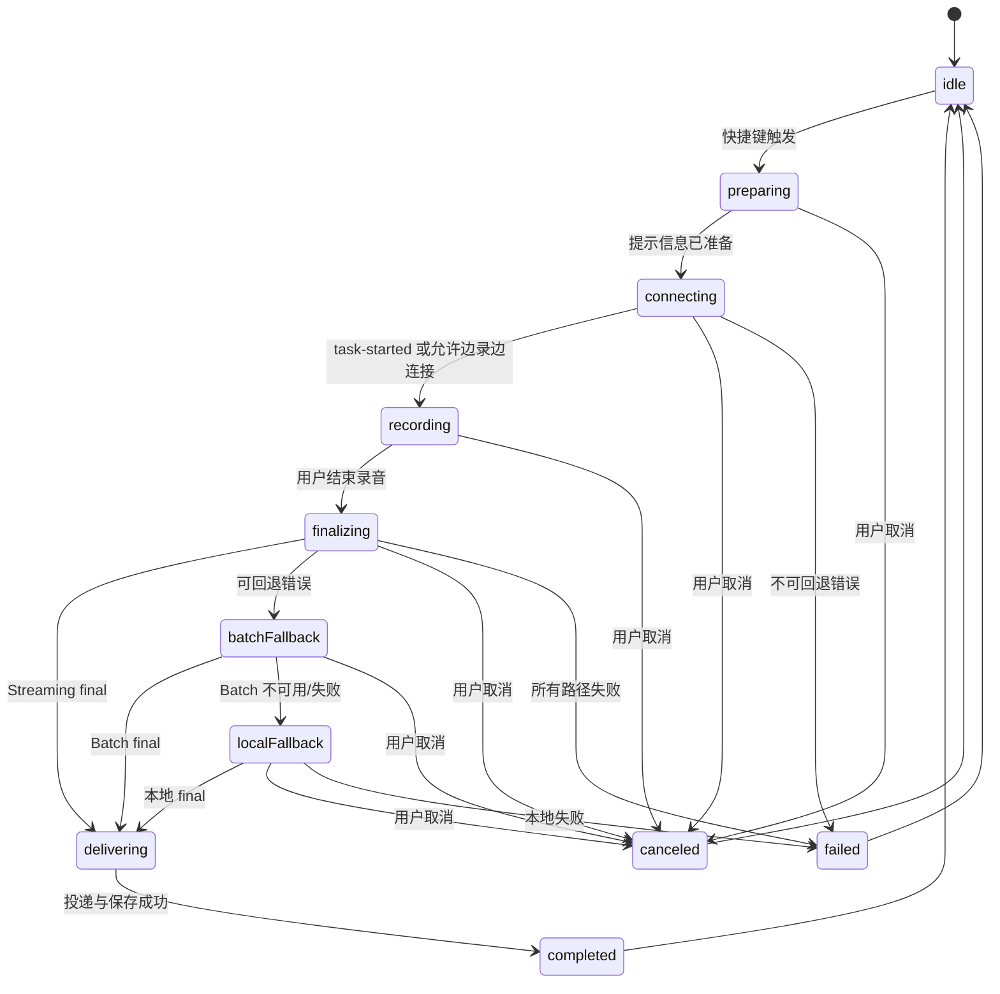
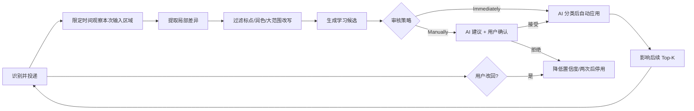

# my-voice 开发设计文档

- 文档版本：v0.2
- 日期：2026-09-19
- 状态：设计基线已实施；A～D 的非凭证功能已完成，真实百炼 Streaming/Batch、两级故障回退和 TextEdit/Chrome/VS Code 投递已通过，个人语料与时序指标验收状态见 [PROGRESS.md](PROGRESS.md)
- 对应需求：[REQUIREMENTS.md](REQUIREMENTS.md) v0.3
- 上游审计基线：VoiceInk [`cd1d96f`](https://github.com/Beingpax/VoiceInk/commit/cd1d96f182b03561f5ef66c6a91e511cd7409c4c)

## 1. 文档目的

本文把已确认的产品需求转换为技术方案，并作为源码导入、模块开发、测试和验收的设计基线。本文本身不包含 Swift 实现代码；当前实现证据、实测边界和外部输入阻塞项统一记录在 [PROGRESS.md](PROGRESS.md)。

本文重点回答：

1. 如何在 VoiceInk 现有架构中加入百炼 Streaming 与 Batch Provider。
2. 如何实现 `Streaming → Batch → SenseVoice Small` 的分级回退。
3. 如何利用本地词库、纠错和反馈形成长期记忆，同时保持轻量化。
4. 如何最小化上传的上下文并保护敏感输入。
5. 如何记录足够的脱敏指标，验证准确率、延迟和资源占用。
6. 如何控制对上游源码的侵入，保留后续同步能力。

## 2. 设计原则

### 2.1 复用上游，不重写系统输入层

VoiceInk 已有录音、流式会话、文件转写、焦点恢复、文本投递、历史记录、Mode、词典、Auto Learn 和本地模型管理。本项目只在这些扩展点上增加能力，不另建第二套录音器、快捷键系统或 Accessibility 写入逻辑。

### 2.2 单进程优先

百炼 Provider、动态热词、上下文裁剪和回退协调都在主应用进程内完成。不引入常驻 Python/Rust daemon，不让 API Key 经过独立本地服务。

### 2.3 Streaming 默认，最终文本原子投递

Streaming partial 只显示在 Floating HUD。MVP 在收到完整 final 后一次性写入目标输入框，避免 partial 回滚、光标漂移以及切换 Batch/本地模型时重复写入。

### 2.4 结构化长期记忆优先

首版以 SwiftData 本地结构化数据、精确匹配和可解释规则排序实现长期记忆。不在实时链路中运行 Embedding 模型或本地大模型。Embedding 不是记忆事实来源，首版也不是候选召回依赖。

### 2.5 隐私默认收敛

完整词库、纠错历史和使用统计留在本机。上传内容限定为本次音频、动态 Top-K 热词、语言提示和经过裁剪的短上下文。安全输入控件和无法确认安全边界的内容一律不上传。

### 2.6 失败可见、结果来源可追踪

回退不能静默发生。每次结果都应能说明来自 Streaming、Batch 还是本地模型，但诊断记录不保存 API Key、原始上下文或完整转写文本。

## 3. 上游能力与改造边界

### 3.1 直接复用的上游模块

| 能力 | 当前上游落点 | 本项目处理 |
|---|---|---|
| 录音与 16 kHz PCM | `Infrastructure/Audio/CoreAudioRecorder.swift` | 原样复用 |
| 单次会话抽象 | `Features/Recording/Workflows/TranscriptionSession.swift` | 扩展回退编排 |
| 流式会话服务 | `Features/Recording/Streaming/StreamingTranscriptionService.swift` | 注册百炼流式 Provider |
| Provider 注册 | `Infrastructure/Providers/Transcription/Cloud/CloudProvider.swift` | 增加百炼 Provider |
| Batch 云转写 | `Infrastructure/Providers/Transcription/Cloud/CloudTranscriptionService.swift` | 接入动态热词和百炼 Batch |
| 服务选择 | `Features/Recording/Workflows/TranscriptionServiceRegistry.swift` | 保持统一入口 |
| 后处理与文本投递 | `TranscriptionPipeline.swift`、`TranscriptionDelivery.swift` | 只增加来源元数据 |
| 上下文采集 | `RecordingContextSnapshot.swift` | 增加隐私策略和裁剪 |
| Keychain | `APIKeyManager.swift`、`KeychainService.swift` | 增加百炼键名与验证 |
| Mode/App/URL | `Features/Modes/`、`Infrastructure/SystemIntegration/Context/` | 作为热词与上下文信号 |
| 词典 | `Features/Dictionary/`、`VocabularyWord.swift` | 保留词条，增加自适应元数据 |
| 纠错学习 | `Features/Dictionary/AutoLearn/` | 复用候选、AI 分类、人工审核或自动应用流程 |
| 本地 SenseVoice | `TranscribeCpp` 相关模块 | 作为默认本地兜底 |
| 历史与清理 | `Features/History/`、`Persistence/Cleanup/` | 增加录音保留策略 |
| 指标 | `SessionMetric.swift`、`SessionMetricRecorder.swift` | 增加 Provider 路径和阶段耗时 |

### 3.2 已实现的新增模块

下表记录设计名称与当前实际落点；与最初建议不同的部分明确列出，避免把设计草案路径误当成现状：

| 模块 | 当前实际位置 | 职责 |
|---|---|---|
| `BailianProvider` / `BailianBatchClient` | `Infrastructure/Providers/Transcription/Cloud/Bailian/` | 百炼 Batch 请求、响应和鉴权验证 |
| `BailianStreamingProvider` / `BailianStreamingSession` | `Infrastructure/Providers/Transcription/Cloud/Bailian/` | WebSocket 生命周期、协议帧和 VoiceInk 流式事件映射 |
| `RecognitionHintSnapshotBuilder` | `Features/Recording/Context/RecognitionHintSnapshot.swift` | 合并热词、语言提示和最小上下文，生成不可变会话快照 |
| `HotwordSelector` | `Features/Recording/Context/RecognitionHintSnapshot.swift` | 候选生成、规则打分、去重和 Top-K |
| `ContextPrivacyPolicy` | `Features/Recording/Context/RecognitionHintSnapshot.swift` | 安全控件检查、拒绝列表、裁剪与审计摘要 |
| `TranscriptionSession` 内的回退编排 | `Features/Recording/Workflows/TranscriptionSession.swift` | Streaming、Batch、本地模型的单次回退决策 |
| `SessionDiagnosticMetric` | `Infrastructure/Persistence/Models/SessionDiagnosticMetric.swift` | 只保存脱敏路径、耗时和错误分类 |
| `AdaptiveTermMetadata` | `Infrastructure/Persistence/Models/AdaptiveTermMetadata.swift` | 保存词条的场景、使用和反馈信号 |
| `CorrectionFeedbackMetadata` | `Infrastructure/Persistence/Models/CorrectionFeedbackMetadata.swift` | 保存纠错规则的接受、撤销和误触发信息 |
| `AudioHistorySettings` / `AudioHistoryCleanupPlanner` | `App/Configuration/AppDefaults.swift`、`Infrastructure/Persistence/Cleanup/AudioCleanupManager.swift` | 原始录音开关、时长/容量上限和清理 |

### 3.3 已完成的上游接入点

| 上游文件或目录 | 已完成改动 |
|---|---|
| `TranscriptionModel.swift` | 增加百炼 Provider 标识与云模型描述 |
| `TranscriptionModelRegistry.swift` | 注册 Streaming 和 Batch 模型 |
| `TranscriptionRealtimeSupport.swift` | 声明百炼 Streaming 支持实时模式 |
| `LanguageDictionary.swift` | 声明百炼支持的语言提示 |
| `CloudProvider.swift` | 将百炼加入 Provider Registry |
| `APIKeyManager.swift` | 增加百炼 Keychain 标识映射 |
| `TranscriptionSession.swift` | 从单级 Streaming→Batch 扩展为受控的第二级本地回退 |
| `ModeRuntimeConfiguration.swift` | 让一次会话携带不可变的识别提示快照 |
| `SessionMetric.swift` / `Transcription.swift` | 保存实际来源、回退路径和必要的脱敏元数据 |
| Provider 设置与 Onboarding | 增加地域、凭证、默认模式和 SenseVoice 安装入口 |
| History 与 Cleanup | 落实原始录音默认关闭和双阈值清理 |

上述改动保持小而可审查；能够通过新模块和组合完成的能力没有为方便而扩大到无关上游核心文件。

### 3.4 不新增的组件

- 不新增独立本地 HTTP 服务。
- 不新增第二套数据库。
- 不新增实时 Embedding、向量数据库或本地 LLM。
- 不重新实现 VoiceInk 的录音、快捷键、历史页、焦点恢复和文本粘贴。
- 不在 MVP 中实现 finalized 句段增量写入。

## 4. 总体架构



### 4.1 数据边界

| 数据 | 默认位置 | 是否上传 |
|---|---|---|
| 原始音频 | 会话临时文件；历史开关开启后才长期保存 | 在线识别时上传本次音频 |
| 完整个人词库 | 本机 SwiftData | 否 |
| Top-K 即时热词 | 会话内存 | 是 |
| 完整选中文本/剪贴板/OCR | 会话内存，使用后释放 | 默认不直接上传 |
| 裁剪后的短上下文 | 会话内存 | 是 |
| API Key | macOS Keychain | 仅作为鉴权请求头发送 |
| 转写文本历史 | 沿用 VoiceInk 本地历史 | 否，除非进入用户启用的在线增强功能 |
| 纠错候选与反馈 | 本机 SwiftData | 默认否 |
| 性能指标 | 本机 SwiftData | 否 |

## 5. 一次听写的完整流程



### 5.1 关键时序约束

1. WebSocket 建立后先发送 `run-task`，收到 `task-started` 后才发送音频。
2. VoiceInk 的音频回调不得等待网络发送完成，网络层必须异步消费。
3. 用户松键后发送 `finish-task`，只有完整 final 才能进入文本投递。
4. partial 和 committed 文本仅用于 HUD 与内部拼接，不直接写入目标应用。
5. 任何回退只允许执行一次同级尝试，禁止无限重试。
6. 取消操作优先级最高：取消后关闭 WebSocket、停止回退、禁止投递并清理临时音频。

## 6. 会话状态机



状态要求：

- 任一时刻最多存在一个活动听写会话。
- 每个会话分配独立 `sessionID`，所有异步回调必须核对该 ID，过期事件不得更新当前 HUD 或投递文本。
- `completed`、`canceled`、`failed` 都必须触发资源清理。
- UI 状态和识别来源分开表示，例如“正在本地回退”不能伪装成普通“处理中”。

## 7. 百炼 Streaming Provider 设计

### 7.1 协议映射

百炼当前 WebSocket 协议使用客户端事件 `run-task`、`continue-task`、`finish-task`，服务端事件包括 `task-started`、`result-generated`、`task-finished`、`task-failed`。实现时映射到 VoiceInk：

| 百炼事件 | VoiceInk 行为 |
|---|---|
| `task-started` | 发出 `.sessionStarted`，开放音频发送门控 |
| `result-generated` 中的非最终结果 | 发出 `.partial(text:)` |
| `result-generated` 中的确认句段 | 更新内部 committed 缓冲；MVP 不直接投递 |
| `task-finished` | 产出完整 final，并结束 `finalizationEvents` |
| `task-failed` | 转为结构化 Provider 错误，交给回退策略 |

MVP 在 `run-task` 时发送一次不可变上下文，不主动发送 `continue-task`。只有后续确认长时间连续听写确实需要会话中更新上下文，才单独设计该能力。

### 7.2 启动参数

Provider 启动时使用一个不可变的会话快照：

- 模型：`qwen-audio-3.0-asr-flash-streaming`
- 音频：PCM、16 kHz、单声道、16-bit little-endian
- 即时热词：`HotwordSelector` 的 Top-K 输出
- 语言提示：默认 `zh`、`en`，允许 Mode 覆盖；最多传递协议支持的数量
- 上下文：`ContextPrivacyPolicy` 输出的短文本
- 断句：初始使用低延迟 VAD，参数必须通过个人语料实测后冻结

截至 2026-09-19，官方推荐使用包含 Workspace ID 的业务空间专属域名。北京地域 HTTP 与 WebSocket 分别使用
`https://{WorkspaceId}.cn-beijing.maas.aliyuncs.com/...` 和
`wss://{WorkspaceId}.cn-beijing.maas.aliyuncs.com/...`；新加坡使用 `ap-southeast-1` 后缀。实现因此将 Workspace ID
作为地域配置的一部分，并保留显式高级端点覆盖，不自动跨地域回退。当天复核详情见
[百炼 ASR 协议复核](BAILIAN_PROTOCOL_2026-09-19.md)。

官方当前规定 Streaming 上下文通过 `input.context` 传入，每轮总长度不超过 400 个字符；即时热词通过 `vocabulary` 传入，权重可为 1～5 或 50。实现必须在客户端再次执行长度、数量和权重校验，不能依赖服务端截断。

### 7.3 音频发送与背压

- CoreAudio 实时线程只负责把 `Data` 交给无阻塞队列，不执行 JSON 编码、网络等待或磁盘清理。
- WebSocket Client 串行发送音频块，保持原始顺序。
- 模式与提示准备、WebSocket 启动期间，流式服务保留最多 20 秒（640 KB）的 PCM16 积压。连接完成后不丢弃已有积压；排空至正常预算后恢复 2 秒（64 KB）的实时队列限制。
- 超过队列预算时，将本次音频标记为不完整并准备完整文件回退；仍发送已接受的音频。只有 provider 终止或发送失败才停止网络发送，不把背压标记当作连接终止。不得静默丢弃音频后继续声称 Streaming 成功。
- 百炼启动期限为 15 秒，覆盖握手、`run-task` 发送和 `task-started`；每次音频及 `finish-task` 发送也有 15 秒期限。超时和取消关闭 transport，释放挂起的底层 WebSocket 操作，而不是仅取消 Swift task。
- 完整录音文件仍由 VoiceInk 录音链路生成，是 Batch 和本地回退的事实来源。
- 断线后不尝试把已过去的实时音频重新注入新 WebSocket；直接进入完整文件回退，逻辑更确定。

### 7.4 final 拼接规则

- Provider 内部分别维护最新 partial、已确认句段和服务端 final。
- UI 可以覆盖显示最新 partial，但存储与投递只接受 final。
- 若 `task-finished` 到达但没有有效文本，按“空 final”处理，而不是成功。
- 去重只能基于服务端提供的句段标识和事件语义；不能使用模糊字符串包含判断删除文本。

### 7.5 连接健康状态

内存中维护 Provider Health：

- `unknown`：尚未验证。
- `healthy`：连接验证或最近请求成功。
- `transientFailure`：超时、断网、429、5xx。
- `invalidCredential`：401、403 或明确鉴权失败。
- `misconfigured`：端点、地域、模型或请求参数无效。

API Key 或地域设置改变时重置为 `unknown`。`invalidCredential` 和 `misconfigured` 使用单调时钟执行 30 秒冷却，期间拒绝网络尝试；冷却到期后下一次录音允许重新探测，局部被拦截的调用不得延长期限。单次请求拒绝（包括无错误字段的 HTTP 400 `{}`）、协议异常和响应异常不视为持久配置故障，允许下一次录音重试；已知无语音业务响应只影响当前录音。

## 8. 百炼 Batch Provider 设计

### 8.1 职责

Batch Provider 有三个用途：

1. 用户主动选择 Batch。
2. Streaming 失败但云端仍可能可用时进行一次完整文件回退。
3. 作为 Streaming 准确率和延迟的 A/B 基线。

MVP 的短句 Batch 模型固定为 `qwen-audio-3.0-asr-flash`。面向长文件和说话人分离的 `qwen-audio-3.0-asr-flash-filetrans` 不进入系统听写主链路。

### 8.2 请求准备

- 复用与 Streaming 相同的 `PreparedRecognitionHints`，保证热词、上下文和语言提示可比较。
- 音频从 VoiceInk 已生成的完整会话文件读取，不重复录音或重新采样，除非官方接口格式要求转换。
- Batch 与 Streaming 使用同一地域配置和同一 Keychain 凭证。
- 请求超时按音频时长设置合理上限，但 MVP 禁止自动重复上传同一音频。

### 8.3 响应处理

- 只接受明确完成且包含有效文本的响应。
- Provider 只返回原始转写，不负责全局替换、格式化或文本投递。
- 请求 ID、HTTP 状态、阶段耗时和错误分类可以进入脱敏指标；请求正文和响应全文不得进入普通日志。

## 9. 分级回退设计

### 9.1 回退路径

```text
Streaming
  ├─ 成功 → final
  ├─ 云端可能仍可用 → Batch（最多一次）
  │                     ├─ 成功 → final
  │                     └─ 失败 → SenseVoice Small
  └─ 明确无网络/云端禁用 → SenseVoice Small
```

### 9.2 错误决策矩阵

| 情况 | 尝试 Batch | 尝试本地 | 用户提示 |
|---|---:|---:|---|
| WebSocket 建连超时但网络可达 | 是 | Batch 失败后是 | Streaming 连接失败，正在切换 |
| 录音中 WebSocket 断开 | 是 | Batch 失败后是 | 实时连接中断，使用完整录音恢复 |
| `task-failed` 暂时性服务错误 | 是 | Batch 失败后是 | 云服务异常，正在切换 |
| 429 限流 | 否或按冷却策略跳过 | 是 | 云端限流，本次使用本地模型 |
| 401/403 | 否 | 是 | 凭证无效，本次使用本地并要求修复设置 |
| 地域/端点/模型配置错误 | 否 | 是 | 配置错误，本次使用本地 |
| 完整 final 为空 | 是 | Batch 失败后是 | 未获得有效结果，正在重试其他路径 |
| 用户取消 | 否 | 否 | 已取消 |
| 无有效语音 | 否 | 否 | 未检测到有效语音 |
| 临时录音文件损坏或缺失 | 否 | 否 | 无法恢复本次录音 |
| 用户选择仅本地模式 | 否 | 是 | 本地识别 |

### 9.3 SenseVoice Small 生命周期

- 首次设置时允许安装约 241 MB 的 SenseVoice Small；必须展示下载进度、校验结果和占用空间。
- 默认不预热、不常驻。只有进入本地模式或回退时才加载。
- 同一会话只加载一个本地模型。
- 本地转写结束后是否立即卸载，由内存实测决定；初始建议在短暂空闲窗口后释放，避免连续失败时反复加载。
- 本地结果进入与云端相同的后处理和投递管线，但指标必须记录实际模型。

## 10. 上下文与热词准备

### 10.1 统一输出

`RecognitionHintBuilder` 为一次会话生成不可变快照，概念字段如下：

| 字段 | 含义 |
|---|---|
| `hotwords` | 已去重、带权重的 Top-K 即时热词 |
| `languageHints` | 本次候选语种 |
| `promptContext` | 最多 400 字符的短上下文 |
| `sourceTypes` | 使用了哪些上下文类型，不包含原文 |
| `privacyDecision` | 允许、裁剪、禁止及原因 |
| `selectionTrace` | 本地调试用的词条得分摘要，不上传 |

### 10.2 上下文采集顺序

1. 取得录音开始时的目标 App、bundle ID、窗口和有效 Mode。
2. 检查是否为安全输入控件，命中则停止内容型上下文采集。
3. 匹配用户 App/URL 拒绝列表；初始列表为空。
4. 根据每类上下文开关，按需读取 URL、选中文本、剪贴板和屏幕文本。
5. 本地抽取字面出现的专业词和短语，不保存完整原文。
6. 构造包含原词的短领域词表；官方说明上下文主要通过词表匹配生效，因此不依赖宽泛的语义描述。
7. 执行 400 字符硬上限和审计摘要生成。
8. 原始上下文在提示信息构造结束后释放。

### 10.3 隐私策略优先级

优先级从高到低：

1. 系统安全输入控件或无法确认安全边界：强制禁止，用户不能覆盖。
2. 仅本地模式：禁止所有音频和上下文上传。
3. 用户拒绝列表：禁止匹配 App/URL 的内容型上下文。
4. Mode 级开关：决定允许读取哪些来源。
5. 全局开关：作为默认值。
6. 长度与内容裁剪：只保留有助于专业词识别的最小信息。

## 11. 长期记忆与动态热词

### 11.1 记忆组成

长期记忆不是模型参数训练，而是本地可审计数据：

| 记忆类型 | 来源 | 用途 |
|---|---|---|
| 标准词 | 用户手动添加、审核通过或自动应用的候选 | 作为热词候选和正确拼写 |
| 常见误识别 | 审核通过或自动应用的纠错 | 安全替换和候选召回 |
| 场景范围 | App、URL、Mode、用户标签 | 缩小热词候选范围 |
| 使用信号 | 选中、命中、最近使用 | 提高常用词排序 |
| 正反馈 | 用户接受纠错 | 提升置信度 |
| 负反馈 | 拒绝、Undo、改回或误吸附 | 降权或停用 |
| 固定状态 | 用户显式固定 | 保证进入候选集 |

### 11.2 存储策略

为减少与上游 `VocabularyWord` 的冲突：

- 保留上游 `VocabularyWord` 作为可见词典和标准词事实来源。
- 新增 `AdaptiveTermMetadata` 侧表，以规范化词条作为关联键，保存场景、权重、计数和时间信号。
- 保留上游 `WordReplacement` 作为替换事实来源。
- 新增 `CorrectionFeedbackMetadata` 侧表，保存替换规则的接受、拒绝、撤销和误触发统计。
- 所有侧表必须有迁移版本、唯一性约束和孤儿数据清理策略。

建议字段：

| 实体 | 关键字段 |
|---|---|
| `AdaptiveTermMetadata` | 规范化词、语言、权重、是否固定、App/URL/Mode 标签、使用次数、正负反馈次数、最近使用时间、启用状态 |
| `CorrectionFeedbackMetadata` | 原文规范化值、目标词规范化值、接受/拒绝/Undo/改回次数、最近触发时间、置信度、启用状态 |
| `RecognitionAttemptMetadata` | 时间、模式、实际 Provider、是否回退、音频时长、各阶段耗时、热词数量、上下文类型、错误分类 |

不保存到指标表：完整音频、完整转写文本、完整上下文、API Key、剪贴板或屏幕内容。

### 11.3 候选生成

候选集合来自：

1. 用户固定词。
2. 当前 App、URL 或 Mode 有明确标签的词。
3. 允许使用的上下文中发生字面命中的标准词或别名。
4. 最近使用和高频词。
5. 近期接受的纠错目标词。
6. 全局词库中少量高置信兜底词。

先生成有限候选，再打分；禁止每次扫描后直接发送全部词库。

### 11.4 初始评分模型

评分只用于排序，不直接等同于百炼热词权重。首轮建议值如下，必须通过 A/B 测试校准：

| 信号 | 初始分值 |
|---|---:|
| 用户固定 | +100 |
| 上下文精确命中标准词/别名 | +40 |
| App 精确匹配 | +30 |
| URL/域名匹配 | +25 |
| Mode 匹配 | +25 |
| 近期审核通过或自动应用的纠错目标 | +20 |
| 最近使用 | 0～+15 |
| 使用频率 | 0～+10，采用对数增长 |
| 曾发生误吸附 | 每次 -20，设下限 |
| 用户改回或拒绝 | -60，并评估停用 |
| 长期未使用 | 0～-10，缓慢衰减 |

选择规则：

- 规范化后去重，保留用户指定的显示形式。
- 默认最少 30、最多 80；候选不足时不为凑数量加入低质量词。
- 固定词优先，但仍受协议数量和合法字符校验约束。
- API 权重默认 4；普通评分升高不会自动变成权重 5 或 50。
- 权重 5 需要用户设置或稳定正反馈；权重 50 只能由用户显式设置。
- 被多次改回或误吸附的词条停用自动选择。

### 11.5 学习闭环



安全约束：

- 只观察本应用刚投递的目标输入控件和本次插入范围。
- 超过观察窗口、焦点无法确认或边界锚点不唯一时放弃学习。
- 大范围删除、整句重写、标点风格和普通措辞变化默认拒绝。
- 用户没有修改时不会产生候选，不从未修改的 ASR 输出猜测永久规则。
- 默认 `Manually`，由 AI 生成建议后再由用户确认；用户可显式选择 `Immediately` 自动应用 AI 分类结果。
- 规则应用后再次被用户改回，必须降低置信度；累计两次负反馈后自动停用。

### 11.6 为什么首版不使用 Embedding

- 当前记忆对象是词、别名、纠错和明确场景标签，结构化检索更准确。
- 缩写、人名和项目名依赖精确拼写，语义相似并不等于应该成为热词。
- 个人词库在首版规模较小，SwiftData 查询和规则打分足够。
- Embedding 增加模型体积、索引生命周期、隐私面和资源占用。
- Embedding 无法判断一次编辑是纠错还是改写，不能替代 Auto Learn 审核。

只有在词库或非结构化资料规模显著增长，并且规则检索的召回率经测量不足时，才单独提交设计变更。即使引入，也只能作为离线候选召回补充，最终仍由精确规则重排。

## 12. 文本后处理与投递

保持上游顺序：

1. Provider 返回原始 final。
2. `TranscriptionOutputFilter` 清理无效输出。
3. Mode 触发与段落格式化。
4. `WordReplacementService` 应用已启用的安全替换规则。
5. 可选 AI Enhancement；不属于本项目 ASR 主链路的必要条件。
6. `TranscriptionDelivery` 一次性写入目标控件。
7. 保存转写历史、来源元数据和脱敏指标。
8. 启动 Auto Learn 观察窗口。

要求：

- Provider 不自行执行替换，避免不同路径结果处理不一致。
- 所有路径共享同一后处理管线。
- 投递前再次核对会话 ID 和目标应用；目标已不可恢复时不向错误应用粘贴。
- 实际 Provider、是否回退和错误路径记录在元数据中，不混入用户文本。

### 12.1 百炼 Qwen Custom Provider

当前个人 `Dictation` Mode 已启用 AI Enhancement，配置如下：

| 项目 | 配置 |
|---|---|
| Provider | `Custom`，显示名 `Bailian Qwen` |
| Endpoint | 当前 Workspace 与 Region 对应的 `https://{workspace}.{region}.maas.aliyuncs.com/compatible-mode/v1/chat/completions` |
| Model | `qwen3.8-flash` |
| Prompt | `语音转写润色`，使用 VoiceInk 系统指令包装 |
| 推理 | 对百炼域名下的 Qwen 请求自动附加 `enable_thinking: false` |
| 凭证 | 复用现有百炼 API Key，并以 Custom Provider 独立 Keychain 项保存 |

`ReasoningConfig.customExtraBodyParameters` 只匹配 `*.aliyuncs.com` 且模型名前缀为 `qwen` 的 Custom Provider，避免把百炼专用参数发送给其他 OpenAI 兼容服务。对应专项测试覆盖百炼 Qwen、非百炼 Qwen 和百炼非 Qwen 三条边界。

当前提示词要求最小化修改，清理无意义的“嗯/呃/那个/就是说”等填充词，修正明显 ASR、标点和断句错误，并保留 Custom Provider、Dictation、Qwen 等中英文混输标识。Auto Learn 继续以用户投递后的实际修改为候选来源，不会把模型润色结果本身直接当作永久纠错事实。

## 13. 原始录音历史与临时文件

### 13.1 两类音频生命周期

| 类型 | 默认行为 | 用途 |
|---|---|---|
| 会话临时录音 | 每次都生成，完成/取消/超时后清理 | Batch 与本地回退 |
| 历史录音 | 默认关闭；用户显式开启后保留 | 用户回听与问题复现 |

### 13.2 保留策略

- 开启历史前显示保存目录、当前占用、保留天数和最大空间。
- 初始值为 7 天或 1 GB，任一条件先达到即清理最旧文件。
- 正在播放、正在导出或仍属于活动会话的文件不得清理。
- “立即清空”只删除历史录音，不删除词库、纠错记录或文本历史；执行前展示影响范围。
- 关闭历史后，新录音不再长期保存；已有历史是否立即删除由用户选择。
- 应用异常退出后，下次启动扫描并清理没有历史记录引用的过期临时文件。

## 14. 凭证、配置与隐私

### 14.1 Keychain

- 百炼 API Key 通过现有 `APIKeyManager` 和 `KeychainService` 保存。
- UserDefaults/SwiftData 只保存“已配置”状态、地域、端点和模型选择，不保存密钥副本。
- 连接验证返回成功、鉴权失败、网络失败或配置失败，不回显完整 Key。
- 日志只允许记录脱敏 Provider 名称、地域和错误分类。

### 14.2 地域一致性

- API Key、HTTP 端点和 WebSocket 端点必须属于同一地域。
- 默认不自动跨地域尝试，避免数据位置和凭证范围发生隐式变化。
- 切换地域时要求重新验证；验证成功前保持旧配置但不混用端点。

### 14.3 日志分级

| 级别 | 允许内容 |
|---|---|
| 普通日志 | sessionID 短标识、阶段、耗时、Provider、错误分类、数量 |
| 调试日志 | 事件类型、队列深度、字符数，不含正文 |
| 禁止记录 | API Key、Authorization、原始音频、完整转写、上下文正文、剪贴板、屏幕文本、热词明文列表 |

## 15. 并发与资源管理

### 15.1 执行域

- `VoiceInkEngine`、界面状态、SwiftData 主上下文继续由 `MainActor` 管理。
- WebSocket 连接、事件解析和发送队列放在独立 actor 或串行执行域。
- 热词选择和上下文裁剪不得阻塞音频回调；需要读取 SwiftData 时先生成不可变快照。
- SenseVoice 加载和推理不能占用主线程。

### 15.2 取消传播

取消必须覆盖：

- 上下文采集任务。
- WebSocket 启动和监听任务。
- 音频发送队列。
- Batch 请求。
- 本地模型加载/推理。
- 后处理与投递。

任何晚到的异步事件都必须因 sessionID 不匹配而被忽略。

### 15.3 资源目标

- 空闲时不加载 SenseVoice、Whisper、Embedding 或本地 LLM。
- WebSocket 只在活动会话存在。
- 识别提示信息构造完毕后释放完整上下文快照。
- 临时音频有单一所有者，避免多个模块各自复制大文件。
- 指标记录批量或异步落盘，不延长用户可感知的 final tail。

## 16. 指标与可观测性

### 16.1 单次会话阶段

记录以下时间点或耗时：

- 快捷键触发。
- Context/Hotword 准备完成。
- WebSocket 开始连接。
- 收到 `task-started`。
- 首个 partial。
- 用户停止录音。
- 发送 `finish-task`。
- 收到 final。
- Batch 回退开始/结束。
- 本地模型加载开始/结束。
- 本地推理开始/结束。
- 文本投递完成。

由此计算：连接耗时、首字延迟、松键到 final、回退耗时、总完成时间和实时系数。

当前 Streaming 实现会在首次向 HUD 发出非空文本时记录从会话启动到该事件的耗时，并在停止路径记录从用户停止到 final 完成的耗时。日志只包含秒数和字符数，不记录转写正文；空 partial/commit 不计作“首个可见 partial”。

### 16.2 结果来源

每次会话记录：

- 用户选择模式。
- 实际成功 Provider。
- 是否发生回退及回退链。
- 错误分类，不保存原始错误正文中的潜在敏感内容。
- 热词候选数、最终发送数和上下文来源类型。
- 音频时长、字符数和模式名称。

### 16.3 准确率评测

个人语料至少 100 条，其中至少 50 条含专业实体。固定同一批音频，比较：

1. 无热词。
2. 全量热词。
3. 动态 Top-K 热词。
4. Streaming。
5. Batch。
6. SenseVoice Small。
7. P1 阶段可选的 Whisper Large v3 Turbo Quantized。

指标：普通文本 CER、专业实体 Recall/Precision、热词误吸附率、最终人工修改率、P50/P95 延迟和失败率。

## 17. 数据迁移与兼容

### 17.1 原则

- 不破坏 VoiceInk 现有 `VocabularyWord`、`WordReplacement`、`Transcription` 和 `SessionMetric` 数据。
- 新字段优先放入侧表，避免大范围修改上游模型。
- 每次 schema 变化都提供从空库、现有 VoiceInk 库和上一版 my-voice 库迁移的测试。
- 迁移失败必须停止写入并给出可恢复提示，不能重建数据库导致历史丢失。

### 17.2 初次迁移

1. 为现有词条生成规范化关联键。
2. 创建缺失的 `AdaptiveTermMetadata`，不擅自增加场景标签或权重。
3. 现有词条默认权重 4、启用、无反馈历史。
4. 现有替换规则创建空的反馈侧表。
5. 重复规范化词条进入迁移报告，由用户处理，不静默合并含义可能不同的词。

## 18. UI 改造清单

### 18.1 Onboarding

- 百炼地域、API Key 和连接验证。
- 默认 Streaming、可切换 Batch/仅本地的说明。
- SenseVoice Small 离线兜底安装，可跳过但明确后果。
- 麦克风、Accessibility；只有启用屏幕上下文时再请求 Screen Recording。
- 原始录音历史保持默认关闭。

### 18.2 设置页

- Provider：地域、端点、Key 状态、重新验证。
- 识别：Streaming/Batch/仅本地、语言提示、VAD 高级设置。
- 回退：是否允许 Streaming→Batch、是否允许云→本地、默认本地模型。
- 词库：标准词、别名、权重、固定状态、场景标签和反馈状态。
- 上下文：分来源开关、自定义 App/URL 拒绝列表、本次发送内容说明。
- 历史：录音保存开关、目录、保留天数、空间上限、立即清空。
- 诊断：最近会话来源、阶段耗时、错误分类和脱敏导出。

### 18.3 Floating HUD

至少区分：

- 正在连接。
- 正在录音并显示 partial。
- 正在等待 final。
- Streaming 失败，正在 Batch 回退。
- 云端不可用，正在加载本地模型。
- 正在本地识别。
- 已取消、失败、完成。

HUD 不显示 API Key、完整上下文或完整热词列表。

## 19. 测试策略

### 19.1 单元测试

| 模块 | 必测内容 |
|---|---|
| 百炼事件解析 | 合法事件、未知字段、乱序、重复、空 final、`task-failed` |
| HotwordSelector | 归一化、去重、场景匹配、负反馈、Top-K、权重边界 |
| ContextPrivacyPolicy | 安全控件、拒绝列表、各来源开关、400 字符裁剪 |
| FailoverCoordinator | 每种错误分类、最多一次回退、取消优先级 |
| 音频所有权 | 完成、失败、取消、崩溃恢复后的清理 |
| 录音保留 | 7 天/1 GB、活动文件保护、立即清空 |
| Auto Learn | 局部纠错、整句改写、标点变化、改回负反馈 |
| 数据迁移 | 空库、现有词典、重复规范化词和迁移失败恢复 |

### 19.2 Provider 集成测试

使用本地可控的 Mock WebSocket/HTTP Server，不依赖真实百炼费用：

- 正常 `run-task → task-started → result-generated → task-finished`。
- `task-started` 前到达音频时的门控。
- partial 多次修订。
- 中途断线。
- `finish-task` 后超时。
- 401、403、429、5xx。
- 大于队列阈值的慢消费。
- 用户取消与服务端晚到事件竞争。

真实百炼测试仅覆盖少量端到端用例和个人语料评测，凭证不得进入测试夹具或 CI。

### 19.3 macOS 端到端测试

至少验证：

- TextEdit/备忘录：普通文本输入。
- Chrome/Safari：普通网页输入框、URL Mode。
- VS Code：中英混输与专业词。
- 终端：普通命令输入，但不得测试或读取密码提示。
- 焦点在录音中切换、目标应用关闭、目标控件消失。
- Push-to-Talk、Toggle、取消、连续快速开始下一次会话。
- 麦克风权限被拒、Accessibility 被撤销、Screen Recording 未授权。
- 断网、弱网、服务端限流和无本地模型。

### 19.4 性能与稳定性测试

- 空闲 30 分钟 CPU/RSS/电量。
- 连续 100 次短句听写成功率。
- 30 分钟连续间歇使用后的内存增长。
- Streaming 首字和 final tail 的 P50/P95。
- 首次与第二次 SenseVoice 回退的加载差异。
- 历史录音达到空间上限时的清理。
- 应用异常退出后临时文件恢复清理。

## 20. 开发阶段与交付物

### 阶段 A：上游基线

目标：得到可重复构建、可运行、权限正确的未定制 VoiceInk。

任务：

1. 将固定提交 `cd1d96f` 的源码快照导入当前仓库，保留 LICENSE 和来源说明。
2. 记录 Xcode、macOS、Swift Package 解析结果和构建命令。
3. 隔离官方自动更新和商业 License 路径，保证本地构建不会被官方包替换。
4. 验证麦克风、Accessibility、可选 Screen Recording、快捷键和本地 SenseVoice。
5. 建立上游差异清单。

验收：无业务改造时即可完成本地录音、转写和文本投递；重启后权限行为稳定。

### 阶段 B1：百炼基础设施

目标：在不接入主录音流程前验证凭证和 Provider 协议。

任务：

1. Keychain 配置、地域/端点和连接验证。
2. Batch Provider 及 Mock 测试。
3. Streaming Provider 及 Mock 测试。
4. 错误分类、Provider Health 和脱敏日志。

验收：固定测试音频可分别通过 Batch 和 Streaming 得到 final，错误分类符合矩阵。

### 阶段 B2：Streaming MVP 主链路

目标：默认 Streaming 可在真实应用中稳定听写。

任务：

1. 接入现有 `TranscriptionSession` 和 `StreamingTranscriptionService`。
2. HUD partial 与 final 原子投递。
3. 完整录音文件所有权和取消清理。
4. Streaming→Batch→SenseVoice 分级回退。
5. 录音历史开关与保留策略。

验收：目标应用中无 partial 重复、无错误焦点投递；三条识别路径均可区分并正常清理。

### 阶段 B3：动态热词与上下文

目标：只上传最相关的词和最小上下文。

任务：

1. 自适应元数据侧表和迁移。
2. 候选生成、规则评分和 Top-K。
3. 上下文隐私策略与 400 字符硬限制。
4. Streaming/Batch 共享提示快照。
5. 选择追踪和隐私审计摘要。

验收：无热词、全量词、动态词三种模式可重复对照；拒绝场景不上传内容型上下文。

### 阶段 C：安全学习

目标：用户审核或显式选择自动应用后的纠错能改善后续识别，且不会把普通改写永久化。

任务：

1. 连接 Auto Learn 候选与自适应元数据。
2. 人工审核、可选自动应用、撤销、改回负反馈和规则停用。
3. 误学习专项测试集。
4. SenseVoice 与量化 Whisper 对照。

验收：预设纠错案例分类正确；普通润色、标点和整句改写不会生成永久规则；Undo 和改回能够降低置信度并停用错误规则。

### 阶段 D：实测优化

目标：根据数据冻结默认参数。

任务：

1. 完成 100 条个人语料 A/B。
2. 冻结 VAD、超时、Top-K 和评分权重。
3. 测量 CPU、RSS、电量、网络和费用。
4. 决定是否保留 SenseVoice 为默认本地模型。
5. 独立评估 finalized 句段增量写入和 AOQ，不自动进入主线。

验收：满足需求文档中的准确率、误吸附率、成功率和性能目标，未达标项有明确数据和后续决策。

## 21. Git 与上游管理

### 21.1 已完成的初次导入历史

当前仓库仍未配置远程；初次导入已经按以下顺序形成可回滚的本地历史：

1. `b235afd`：提交需求与开发设计，形成项目决策基线。
2. `d99c4dd`：将 VoiceInk 固定提交的源码快照独立导入，不携带上游 `.git`。
3. `ab9dd37` 起：增加 `UPSTREAM.md` 并完成本地构建、身份与数据隔离。
4. `8eda565` 至 `30a2d9f`：按 Provider、流式回退、动态提示、安全学习、历史指标和引导流程分模块提交，没有混入全仓格式化。

本文不授权添加远程、推送或创建发布；这些操作需要后续明确决定。

### 21.2 上游同步

- 每次同步先在临时目录取得候选上游提交。
- 比较迁移、Provider、录音、投递、权限、自动更新和 License 相关差异。
- 先合并纯上游变更，再单独适配 my-voice 模块。
- 完成构建、迁移和端到端回归后才更新 `UPSTREAM.md` 的固定 SHA。
- 不直接追随浮动 `main` 构建日常使用版本。

## 22. 风险与缓解

| 风险 | 影响 | 缓解 |
|---|---|---|
| 百炼协议字段或事件变化 | 流式不可用 | Provider 隔离、事件容错、实现前复核官方文档 |
| Streaming partial 反复修订 | 重复文本或光标错乱 | MVP 只在 final 后原子投递 |
| 网络慢导致音频队列积压 | 丢音或延迟失控 | 队列阈值触发完整文件回退，不静默丢帧 |
| Batch 与 Streaming 结果处理不一致 | 难以比较和学习 | 共享提示快照与后处理管线 |
| 热词权重过高 | 普通词误吸附 | 默认 4、负反馈、超级热词必须用户显式设置 |
| 普通改写被当成纠错 | 永久错误规则 | 局部边界、AI 分类、人工审核或显式自动应用、Undo 与改回负反馈 |
| 本地模型首次加载慢 | 回退体验差 | HUD 明示加载；实测后决定短暂缓存窗口 |
| SwiftData schema 演进 | 历史数据损坏 | 侧表、迁移测试、失败停止写入 |
| 上游更新冲突 | 维护成本上升 | 新增模块优先、固定 SHA、独立上游导入提交 |
| 原始录音占满磁盘 | 系统空间风险 | 默认关闭、7 天/1 GB 双阈值、立即清空 |
| 日志泄露敏感内容 | 隐私风险 | 字段白名单和脱敏测试 |

## 23. 基线与外部输入检查表

- [x] 需求文档 v0.3 已确认；当前 Auto Learn 闭环与百炼文本润色补充均已对齐实现和验证边界。
- [x] 当前文档先形成独立本地提交。
- [x] 再次验证 VoiceInk 固定提交可获取且 LICENSE 未变化。
- [x] 在目标 Mac 上记录 Xcode、macOS 和芯片信息。
- [ ] 取得普通百炼按量 API Key，并确认地域。
- [x] 实现当天重新核对百炼 Streaming、Batch、热词和上下文官方协议。
- [x] 明确 Mock Server 测试边界，真实 Key 不进入仓库。
- [ ] 准备首批 20 条冒烟语料和后续 100 条完整评测语料。
- [x] 确认原始录音历史默认关闭。
- [x] 确认不添加远程、不推送、不发布，除非收到新的明确授权。

## 24. 参考资料

- [产品需求文档](REQUIREMENTS.md)
- [VoiceInk 官方仓库](https://github.com/Beingpax/VoiceInk)
- [VoiceInk GPL-3.0](https://github.com/Beingpax/VoiceInk/blob/main/LICENSE)
- [百炼语音识别模型概述](https://help.aliyun.com/zh/model-studio/asr-model)
- [百炼实时语音识别客户端事件](https://help.aliyun.com/zh/model-studio/fun-asr-client-events)
- [百炼实时语音识别服务端事件](https://help.aliyun.com/zh/model-studio/fun-asr-server-events)
- [百炼提升识别准确率](https://help.aliyun.com/zh/model-studio/improve-asr-accuracy)
